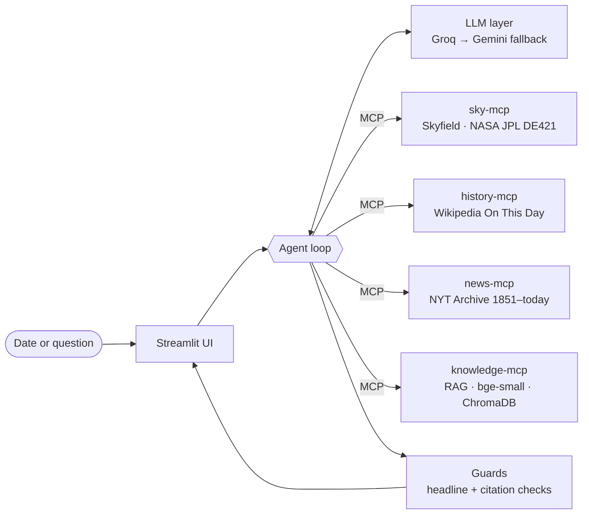

# 🔭 Chronoscope

**Pick any date. An AI agent researches history, real newspaper front pages and the night sky, then writes a cited "time capsule".**


> *"What was the world like on 9 November 1989?"*
> The agent finds the fall of the Berlin Wall, pulls the next morning's New York Times front page
> (*"Joyous East Germans Pour Through Wall…"*), computes the sky over Berlin that night
> (waxing gibbous Moon in the SW, Jupiter in the E), and explains why it mattered, citing every sentence.

---

## How it works



1. **The agent discovers tools at runtime** from four independent [MCP](https://modelcontextprotocol.io) servers. Nothing is hard-coded.
2. **The LLM decides what to call:** events and headlines first, then the sky *at the place of the event*
   (it picked the Baikonur launch site's coordinates for Gagarin's flight by itself), then RAG research.
3. **RAG grounds the facts:** the full Wikipedia article is chunked, embedded locally and searched; the answer cites passages `[1] [2]`.
4. **Guards verify the output before the user sees it.**

## Engineering decisions

| Problem | Solution |
|---|---|
| LLMs invent newspaper headlines | **Headline guard:** every quoted headline is checked against the real NYT data and removed if not found |
| LLMs cite sources that don't exist | The agent, not the LLM, assigns citation numbers and builds the source list; unknown refs are stripped |
| Free LLM tiers are rate-limited and overloaded | **Multi-provider fallback** (Groq → Gemini), honours `retry-after`, model discovery instead of hard-coded names |
| Small models stop early or return empty replies | **Plan check:** the agent verifies required tools were called and sends the model back if not |
| Small models send wrong argument types | Arguments are coerced to each tool's JSON schema before the call |
| Secrets leaking to tools | **Least privilege:** each MCP server gets only the env vars it needs (news gets the NYT key, nothing else) |
| API quotas (NYT: 500 requests/day) | SQLite cache: one API call per month of newspapers, ever |
| Slow repeated research | Articles are embedded once and persisted in ChromaDB (2nd query: ~0.2 s) |

## Tech stack

**Python** · **MCP** (Model Context Protocol, v2 SDK) · **Groq** (gpt-oss-120b) / **Gemini** via OpenAI-compatible APIs ·
**RAG** with **fastembed** (BAAI/bge-small-en-v1.5) + **ChromaDB** · **Skyfield** · **Streamlit** · **SQLite** · **pytest-style tests**

Everything runs on free tiers; the embedding model runs locally on CPU.

## Project structure

## Run it

```bash
pip install -r requirements.txt
export GROQ_API_KEY=...   # free at console.groq.com
export NYT_API_KEY=...    # free at developer.nytimes.com (Archive API)
export GEMINI_API_KEY=... # optional fallback, free at aistudio.google.com

streamlit run app.py                      # web UI
python agent/agent.py "12 April 1961"     # or the command line
```

## Tests

```bash
python tests/test_sky_mcp.py        # sky server over MCP
python tests/test_history_mcp.py    # Wikipedia server + cache
python tests/test_news_mcp.py       # NYT server, front-page ranking
python tests/test_knowledge_mcp.py  # RAG retrieves the right passage
python tests/test_guard.py          # hallucination guards (no network)
python tests/test_agent.py          # end to end: all servers used, cited capsule
```

## Limitations & roadmap

- Sky data covers 1900–2050 (JPL DE421 ephemeris); newspapers start in Sept 1851
- Places outside the built-in city list need coordinates → **next: free geocoding for any town**
- One newspaper → **next: multi-source news** (Chronicling America 1770–1963, The Guardian 1999+, GDELT, RSS)
- Deployment (Docker → Hugging Face Spaces) planned

## Data & credits

Wikipedia (CC BY-SA) · The New York Times Archive API (non-commercial use) · NASA JPL DE421 ephemeris via Skyfield ·
BAAI bge-small-en-v1.5. Headlines are shown as short quotes with links to the source.

MIT License © 2026 Prashant Pandey
